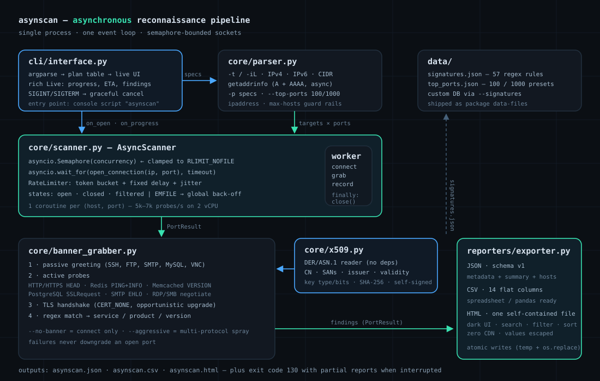

# asynscan

**Asynchronous port scanner, banner grabber & TLS certificate inspector** — a single-process
`asyncio` reconnaissance tool that sweeps large CIDR ranges in seconds, fingerprints the
services behind every open port and writes JSON / CSV / standalone HTML reports.

<p align="center">
  
  
  
  
  
  
  
  
  
</p>

---

## ⚠️ Ethical use disclaimer

`asynscan` is a professional reconnaissance tool. It is intended **only** for systems you own
or for which you hold **explicit, written authorisation** (signed scope, rules of engagement,
bug bounty policy). Port scanning third-party infrastructure without permission may violate
computer-misuse legislation (e.g. CFAA, UK Computer Misuse Act, EU Directive 2013/40/EU) and
contractual terms.

The authors accept **no liability** for misuse or for any damage caused by this software.
Reports generated by this tool may contain sensitive data — store and share them accordingly.

---

## Table of contents

- [Why this tool](#why-this-tool)
- [Architecture](#architecture)
- [Install](#install)
- [Quick start](#quick-start)
- [CLI reference](#cli-reference)
- [Fingerprinting engine](#fingerprinting-engine)
- [Report formats](#report-formats)
- [Benchmarks](#benchmarks)
- [Performance & descriptor tuning](#performance--descriptor-tuning)
- [Project layout](#project-layout)
- [Development](#development)
- [Docker](#docker)
- [Troubleshooting](#troubleshooting)
- [License](#license)

---

## Why this tool

| | |
|---|---|
| **One event loop, thousands of sockets** | A coroutine per `(host, port)` pair with a global `asyncio.Semaphore`. No thread-per-connection, no 16 GB RSS. |
| **Descriptor-aware** | Concurrency is clamped against `RLIMIT_NOFILE`, and `EMFILE`/`ENFILE` triggers a global back-off instead of a crash. |
| **Real fingerprints, not guesses** | Passive greeting capture → protocol-aware active probes → regex signature DB (57 rules) → TLS certificate decode. |
| **Zero compiled dependencies** | Certificates are parsed from DER with a built-in ASN.1 reader; only `rich` and `aiofiles` are required. |
| **Reports that survive the engagement** | Versioned JSON schema, spreadsheet-ready CSV, and a single-file dark-mode HTML report with search, filtering and sortable columns. |
| **Interrupt-safe** | `Ctrl+C` cancels gracefully, keeps partial findings and still writes every requested report. |

---

## Architecture



<details>
<summary>ASCII view (same pipeline, text only)</summary>

```text
                            ┌──────────────────────────── CLI (rich) ────────────────────────────┐
                            │  argparse → plan table → live progress → findings table → summary  │
                            └───────────────▲───────────────────────────────┬────────────────────┘
                                            │ on_open / on_progress         │ targets + ports
                                            │                               ▼
 ┌───────────────┐   spec strings   ┌────────┴──────────────────────────────────────────────────┐
 │  -t / -iL /   │ ───────────────▶ │ core/parser.py                                            │
 │  -p / --top-  │                  │  ipaddress (CIDR/A/AAAA) · getaddrinfo (async) · presets  │
 │  ports        │                  └────────┬──────────────────────────────────────────────────┘
 └───────────────┘                           │ list[Target] × list[int]
                                             ▼
                            ┌────────────────────────────────────────────────┐
                            │ core/scanner.py   AsyncScanner                 │
                            │  asyncio.Semaphore(concurrency)                │
                            │  asyncio.wait_for(open_connection, timeout)    │
                            │  RateLimiter (token bucket + delay/jitter)     │
                            └───────┬──────────────────────────────┬─────────┘
                                    │ open socket                  │ closed / filtered / timeout
                                    ▼                              ▼
                 ┌────────────────────────────────────┐      ┌───────────────┐
                 │ core/banner_grabber.py             │      │ state counters│
                 │  1. passive read (SSH, FTP, SMTP…) │      └───────┬───────┘
                 │  2. active probes  (HTTP HEAD,     │              │
                 │       PING, version, EHLO, SSLReq) │              │
                 │  3. TLS handshake ─▶ core/x509.py  │              │
                 │       CN · SAN · issuer · expiry   │              │
                 │  4. regex match ─▶ data/signatures │              │
                 └───────────────┬────────────────────┘              │
                                 │ PortResult                          │
                                 ▼                                     ▼
                        ┌──────────────────────────────────────────────────┐
                        │ reporters/exporter.py                            │
                        │   JSON (schema v1) · CSV · standalone HTML       │
                        └──────────────────────────────────────────────────┘
```

</details>

### Design decisions that matter

- **One FD per probe.** The connect socket is reused for passive reading and active probing.
  TLS inspection re-connects (a plaintext socket cannot be upgraded portably), so the rule of
  thumb is `concurrency ≤ ulimit -n / 2`. The scanner enforces this automatically.
- **Banner grabbing never downgrades a finding.** A silent daemon is still an open port: any
  failure inside the grabber is recorded as a port-level `error`, not as `filtered`.
- **Only open ports are materialised.** Per-host `closed_port_count` / `filtered_port_count`
  counters keep memory flat on `/16 × 65k` runs while the report stays accurate.
- **Probe discipline.** Silent binary protocols (Redis, Memcached, PostgreSQL, RDP, SMB) are
  probed *before* the banner window is wasted; unknown ports get a single HTTP `HEAD`, and
  multi-protocol spraying only happens with `--aggressive`.

---

## Install

```bash
# from a checkout
python3 -m venv .venv && source .venv/bin/activate
pip install -e .            # or: pip install -e ".[dev]"

# from a wheel / sdist
pip install .
```

Requirements: **Python 3.10+**, `rich`, `aiofiles`. No compiler, no OpenSSL headers.

Running from source without installing also works:

```bash
python3 main.py --help
```

No network stack? Explore the tool against a local lab instead of a target:

```bash
python3 scripts/demo_lab.py        # fake SSH/HTTP/Redis/TLS services + reports/demo.*
```

---

## Quick start

```bash
# 1) Fast sweep of a /24 using the 100 most common ports, HTML report
asynscan -t 192.168.1.0/24 --top-ports 100 -oH lan.html

# 2) Focused service + certificate check on a single host
asynscan -t example.com -p 22,80,443,8080,8443 --timeout 1.5 -oJ out.json -oC out.csv

# 3) Big engagement: target file, 1000 ports, high concurrency
ulimit -n 65535
asynscan -iL targets.txt --top-ports 1000 -c 2000 --rate 400 -oA reports/day1

# 4) Stealthier profile: throttled, jittered, shuffled port order
asynscan -t 10.0.0.0/24 -p 1-1024 -c 50 --delay 0.05 --jitter 0.1 --rate 20 --shuffle --seed 7

# 5) Silent hosts, hunting web ports on odd numbers
asynscan -t 10.0.0.5 -p 1-10000 --aggressive -oH svc.html
```

### Local preview console

The repository ships a tiny offline console (`scripts/preview_server.py`) that renders the demo
findings, the signature database and the CLI reference in the browser — handy for reviewing
output without a terminal:

```bash
python3 scripts/demo_lab.py       # generate reports/demo.* from the loopback lab
make preview                      # serve http://0.0.0.0:32929
make check-preview                # is the running console up AND on the current build?
```

`/healthz` reports the console build, its start time and which report it is serving.
Because a long-running preview keeps its module in memory, a stale process would silently
serve old HTML — `scripts/check_preview.py` compares the running build with the on-disk one
and exits non-zero on a mismatch (or when nothing is listening).

It binds `0.0.0.0`, writes no files, makes no outbound requests, and falls back to the committed
sample in `examples/demo_report.json` when no fresh report exists.

### Live terminal output

```text
╭───────────────────────────────── scan plan ──────────────────────────────────╮
│     targets  254 host(s)                                                     │
│       ports  100 per host                                                    │
│      probes  25,400                                                          │
│ concurrency  500                                                             │
│       scope  192.168.1.1, 192.168.1.2, 192.168.1.3 … (+251 more)             │
╰──────────────────────────────────────────────────────────────────────────────╯
  scanning 25,400 probe(s)…          ← live panel (TTY) or periodic lines (pipe/CI)
127.0.0.1:32929 OpenSSH/9.6p1   SSH-2.0-OpenSSH_9.6p1 Ubuntu-3ubuntu13.5
127.0.0.1:44525 nginx/1.24.0    HTTP/1.1 200 OK | Server: nginx/1.24.0 | X-Powered-By: PHP/8.2.1
127.0.0.1:44847 nginx/1.24.0    CN=scanner-test.example | issuer=scanner-test.example | expires=2026-12-15 | TLSv1.3
127.0.0.1:34057 redis   +PONG

                           findings (5 open port(s))
  IP           Port   State   Service         Banner / TLS Info              Latency (ms)
 ────────────────────────────────────────────────────────────────────────────────────────
  127.0.0.1   32929   open    OpenSSH/9.6p1   SSH-2.0-OpenSSH_9.6p1 …              1.59
  127.0.0.1   34057   open    redis           +PONG                                1.59
  127.0.0.1   44525   open    nginx/1.24.0    HTTP/1.1 200 OK | Server: nginx …    1.57
  127.0.0.1   44847   open    nginx/1.24.0    CN=scanner-test.example | TLSv1.3    1.57

╭────────────────────────── scan summary — complete ───────────────────────────╮
│              duration │ 0.6s                                                 │
│                probes │ 1,000                                                │
│            throughput │ 1,794 probes/s                                       │
│                 hosts │ 1 (5 open port(s))                                   │
│     closed / filtered │ 995 / 0                                              │
│          top services │ nginx/1.24.0 ×2 · OpenSSH/9.6p1 ×1 · redis ×1         │
╰──────────────────────────────────────────────────────────────────────────────╯
╭────────────────────────────── reports written ───────────────────────────────╮
│ JSON  reports/demo.json     CSV  reports/demo.csv     HTML  reports/demo.html │
╰──────────────────────────────────────────────────────────────────────────────╯
```

---

## CLI reference

### Targets

| Flag | Description |
|---|---|
| `-t, --target TARGET` | IPv4/IPv6 address, hostname or CIDR. Repeatable and comma-separated: `-t 10.0.0.5,example.com -t 10.0.1.0/24` |
| `-iL, --input-list FILE` | Target file, one entry per line, `#` comments and inline comments supported. Repeatable. |
| `--max-hosts N` | Abort/truncate when the expanded scope exceeds `N` hosts (default **65,536**). |
| `--no-resolve` | Skip DNS; useful for pure IP/CIDR scans and offline inventories. |
| `--dns-timeout SEC` | Per-host resolver timeout (default **5.0**). |

### Ports

| Flag | Description |
|---|---|
| `-p, --ports SPEC` | `80`, `22,80,443,3306,8080`, `1-65535`, `1-1024,3306,8080`, `all` (or `-`). Whitespace tolerated. |
| `--top-ports {100,1000}` | Built-in presets (see `data/top_ports.json`). Combines with `-p`. |
| `--max-ports N` | Safety cap on ports per host (default **65,535**). |
| `--shuffle`, `--seed N` | Randomise port order; seed for reproducible ordering. |

### Performance & stealth

| Flag | Default | Description |
|---|---|---|
| `-c, --concurrency N` | `500` | Max in-flight probes. Auto-clamped to `ulimit -n` budget. |
| `--timeout SEC` | `2.0` | Per-port connect timeout (`asyncio.wait_for`). |
| `--banner-timeout SEC` | `1.0` | Banner read window / drain timeout. |
| `--retries N` | `0` | Retries for non-open results (e.g. transient `EMFILE`). |
| `--delay SEC` | `0` | Fixed sleep before each probe. |
| `--jitter SEC` | `0` | Adds `random(0, SEC)` on top of `--delay`. |
| `--rate N` | `0` | Global token-bucket cap in probes/second (`0` = unlimited). |

### Fingerprinting

| Flag | Description |
|---|---|
| `--no-banner` | Connect-only mode: fastest possible sweep. |
| `--aggressive` | Multi-protocol spray (Redis → Memcached → HTTP → CRLF) on unknown ports, one payload per connection. |
| `--no-tls` | Disable TLS handshakes and certificate decoding. |
| `--tls-all` | Attempt TLS on *every* open port (finds TLS on 993/8443/… and custom ports). |
| `--tls-min {1.0,1.1,1.2,1.3}` | Minimum negotiated TLS version (default: library default). |
| `--no-sni` | Do not send SNI (useful against virtual hosts that reject it). |
| `--signatures FILE` | Custom signature database (same schema as `data/signatures.json`). |

### Reporting & UI

| Flag | Description |
|---|---|
| `-oJ, --json FILE` | JSON report (schema v1). |
| `-oC, --csv FILE` | CSV report, one row per open port. |
| `-oH, --html FILE` | Self-contained dark-mode HTML report. |
| `-oA, --all PREFIX` | Writes `PREFIX.json`, `PREFIX.csv`, `PREFIX.html`. |
| `--report-dir DIR` | Base directory for relative report paths. |
| `--show-closed` | Include closed/filtered ports in the console table. |
| `-q, --quiet` | No live UI; prints one line per open port (script friendly). |
| `--no-color`, `-v/--verbose` | Disable ANSI colours / print extra diagnostics. |

Exit codes: `0` success, `2` invalid scope or ports, `3` report write failure, `130` interrupted
(partial reports are still written).

---

## Fingerprinting engine

**1. Passive greeting** — chatty daemons are read for a bounded window (≤ 512 B, `--banner-timeout`):
SSH, FTP, SMTP, POP3, IMAP, Telnet, MySQL/MariaDB handshake, VNC, and TLS servers that answer
with a TLS alert on a plaintext port (opportunistic upgrade).

**2. Active probes** — sent only when the passive read was silent or unhelpful:

| Probe | Payload (abridged) | Ports |
|---|---|---|
| `http-head` | `HEAD / HTTP/1.1\r\nHost: …\r\nConnection: close` | 80, 8080, 8000, 8888, 9200 … + every unknown port |
| `https-head` | same, over TLS | 443, 8443, 9443, 993, 995 … |
| `redis-ping` (+ `INFO server` for version) | `PING\r\n` | 6379, `--aggressive` |
| `memcached-version` | `version\r\n` | 11211, `--aggressive` |
| `postgres-sslrequest` | `\x00\x00\x00\x08\x04\xd2\x16\x2f` | 5432 |
| `smtp-ehlo` | `EHLO asynscan.local\r\n` | 25, 587, 2525 |
| `rdp-negotiate` | TPKT/X.224 negotiation | 3389 |
| `smb-negotiate` | SMB1+SMB2 negotiate | 445, 139 |
| `generic-crlf` | `\r\n` | `--aggressive` only |

**3. TLS inspection** — `ssl` context with `CERT_NONE` + `check_hostname=False` (we inspect, we do
not trust), `SECLEVEL=0` ciphers so legacy appliances answer. The DER certificate is decoded by
`core/x509.py`: **CN, SANs (DNS + IP), issuer CN/O, validity, days remaining, expired,
self-signed, serial, signature algorithm, key type/bits, SHA-256 fingerprint, negotiated version
and cipher**. No `cryptography` dependency.

**4. Signature matching** — captured text is matched against `data/signatures.json`
(57 rules: SSH, FTP, SMTP, POP3/IMAP, nginx/Apache/IIS/Caddy/Envoy/Tomcat/Jetty/Gunicorn, PHP,
Express, OpenSSL, MySQL/MariaDB, PostgreSQL, Redis, Memcached, SMB, RDP, VNC, MongoDB,
Elasticsearch, ZooKeeper, Docker, Kubernetes). Rules expose named groups `product` and `version`
and may override the port-derived `service`. A malformed rule is skipped, never fatal.

```bash
# add your own rule (matched in file order, first hit wins)
{
  "id": "acme-appliance",
  "service": "acme",
  "pattern": "ACME (?P<product>EdgeBox) v(?P<version>[\\\\d.]+)"
}
```

---

## Report formats

### JSON (schema v1)

```json
{
  "scan": {
    "schema_version": "1.0",
    "started_at": "2026-11-15T18:41:22+00:00",
    "finished_at": "2026-11-15T18:41:24+00:00",
    "duration_seconds": 1.708,
    "cancelled": false,
    "tool": "asynscan",
    "tool_version": "1.0.0",
    "command": "asynscan -t 127.0.0.1 -p 32929,34057,44525,44847 -c 20 -oJ out.json",
    "arguments": {
      "targets": ["127.0.0.1"], "ports": 4, "port_list": [32929, 34057, 44525, 44847],
      "port_preset": null, "concurrency": 20, "timeout": 1.2, "banner_grab": true,
      "tls_inspection": true, "rate_limit": 0.0, "resolve_dns": true,
      "aggressive": false, "tls_all_ports": false
    }
  },
  "summary": {
    "hosts_scanned": 1, "hosts_with_open_ports": 1, "open_ports": 4,
    "closed_ports": 0, "filtered_ports": 0, "probes": 4,
    "average_latency_ms": 0.91, "requests_per_second": 2.33,
    "top_services": [{"service": "nginx/1.24.0", "count": 2}],
    "state_counts": {"open": 4, "closed": 0, "filtered": 0}
  },
  "warnings": [],
  "hosts": [
    {
      "ip": "127.0.0.1", "hostname": "localhost", "is_ipv6": false,
      "probed": 4, "closed_port_count": 0, "filtered_port_count": 0, "open_port_count": 4,
      "ports": [
        {
          "port": 44525, "protocol": "tcp", "state": "open",
          "service": "http", "product": "nginx", "version": "1.24.0",
          "banner": "HTTP/1.1 200 OK | Server: nginx/1.24.0 | X-Powered-By: PHP/8.2.1",
          "banner_raw": "HTTP/1.1 200 OK | Server: nginx/1.24.0 | X-Powered-By: PHP/8.2.1",
          "probe": "http-head", "fingerprint": "http-nginx",
          "latency_ms": 0.9, "scanned_at": "2026-11-15T18:41:22+00:00", "tls": null
        },
        {
          "port": 44847, "protocol": "tcp", "state": "open",
          "service": "https", "product": "nginx", "version": "1.24.0",
          "banner": "HTTP/1.1 200 OK | Server: nginx/1.24.0",
          "probe": "https-head", "fingerprint": "http-nginx",
          "latency_ms": 0.9, "scanned_at": "2026-11-15T18:41:22+00:00",
          "tls": {
            "subject_cn": "scanner-test.example",
            "sans": ["scanner-test.example", "www.scanner-test.example", "127.0.0.1"],
            "issuer_cn": "scanner-test.example", "issuer_org": "Test Org",
            "not_before": "2026-11-15T18:28:48+00:00",
            "not_after": "2026-12-15T18:28:48+00:00",
            "days_remaining": 29, "expired": false, "self_signed": true,
            "serial": "3D84C8E6BC973665C0D6821AE616AB4781F80055",
            "signature_algorithm": "sha256WithRSAEncryption",
            "tls_version": "TLSv1.3", "cipher": "TLS_AES_256_GCM_SHA384 (TLSv1.3)",
            "key_type": "RSA", "key_bits": 2048,
            "sha256": "d7eb00ca8a22fc54022b3fba667c39b7d4f6655568da18ef0ffc84e3703179c2",
            "error": null
          }
        }
      ]
    }
  ]
}
```

### CSV

```csv
timestamp,ip,hostname,port,protocol,state,service,product,version,banner,tls_cn,tls_issuer,tls_expires,latency_ms
2026-11-15T18:41:18+00:00,127.0.0.1,localhost,32929,tcp,open,OpenSSH/9.6p1,OpenSSH,9.6p1,SSH-2.0-OpenSSH_9.6p1 Ubuntu-3ubuntu13.5,,,,1.59
2026-11-15T18:41:18+00:00,127.0.0.1,localhost,34057,tcp,open,redis,,,+PONG,,,,1.59
2026-11-15T18:41:18+00:00,127.0.0.1,localhost,44847,tcp,open,nginx/1.24.0,nginx,1.24.0,HTTP/1.1 200 OK | Server: nginx/1.24.0,scanner-test.example,scanner-test.example,2026-12-15T18:28:48+00:00,1.57
```

### HTML

`-oH report.html` produces **one file** (~15 KB per 10 findings) with no external CSS, JS, fonts
or images — safe to open offline, attach to a ticket or archive:

- summary cards: hosts scanned, hosts with open ports, open ports, filtered, expired certificates;
- "top services" and average latency cards;
- instant search box (IP, hostname, port, service, banner, TLS CN/SAN) and a service filter;
- click-to-sort columns; TLS rows show CN, up to four SANs, issuer, expiry (flagged when expired
  or self-signed) and negotiated TLS version;
- every value is HTML-escaped, so a hostile banner cannot inject script into your report.

---

## Benchmarks

Measured on a **2 vCPU, 1 GB container** (Python 3.11, loopback targets, `ulimit -n 65535`,
`-c 800`, connect-only). Loopback is the worst case for per-connection CPU overhead, so real
LAN/WAN numbers are usually *lower* per probe but benefit more from concurrency.

| Scenario | Probes | Duration | Throughput |
|---|---:|---:|---:|
| Single host, 20,000 ports (`-c 400`) | 20,000 | 2.7 s | **7,296 probes/s** |
| Single host, full 1–65535 sweep (`-c 800`) | 65,535 | 11.1 s | **5,882 probes/s** |
| `/25` sweep — 126 hosts × 1,000 ports | 126,000 | 23.3 s | **5,416 probes/s** |
| `/24` sweep with banners+TLS partially open (`-c 1000`) | 50,800 | 9.2 s | **5,527 probes/s** |

Rules of thumb for a 500 ms RTT target with `-c 500`: **~1,000 ports/s per host-equivalent**,
i.e. a `/24 × 1,000 ports` (254k probes) finishes in roughly **4–9 minutes** on a small VPS.

> Banner grabbing and TLS inspection dominate runtime on *open* ports (each costs at least one
> round-trip plus the `--banner-timeout` read window). Use `--no-banner` for pure discovery, then
> re-scan only the open ports with fingerprinting enabled.

---

## Performance & descriptor tuning

```bash
ulimit -n 65535          # raise the soft limit (or 200000 on busy hosts)
asynscan ... -c 2000
```

- The tool prints a warning and **clamps** `-c` to about `ulimit -n × 0.75 / 2` when you ask for
  more than the descriptor budget allows.
- `EMFILE`/`ENFILE` is caught per probe: a single global back-off, one retry, and a clear warning
  in the report metadata instead of a dead scan.
- Concurrency guidance: `c ≈ RTT_seconds × target_probes_per_second`, capped by the FD budget.
- For stealth, prefer `--delay`, `--jitter`, `--rate` and `--shuffle` over lowering `-c` alone:
  concurrency controls parallelism, the limiter controls observable pacing.

---

## Project layout

```text
.
├── main.py                     # thin wrapper: python3 main.py …
├── pyproject.toml              # packaging, console_scripts, ruff & pytest config
├── requirements.txt            # runtime deps
├── Dockerfile                  # multi-stage slim build, non-root user
├── Makefile                    # make test / lint / scan / docker
├── data/
│   ├── signatures.json         # 57 regex fingerprint rules
│   └── top_ports.json          # --top-ports 100 / 1000 presets
├── core/
│   ├── parser.py               # targets (IP/host/CIDR/file) + port specs
│   ├── scanner.py              # AsyncScanner: semaphore, timeouts, rate limit, states
│   ├── banner_grabber.py       # passive reader, active probes, signature matching
│   ├── x509.py                 # dependency-free DER/X.509 parser
│   ├── models.py               # PortResult / HostResult / TLSInfo
│   └── paths.py                # bundled-data resolution (checkout, pip, Docker)
├── cli/
│   └── interface.py            # argparse + rich UI + orchestration + SIGINT handling
├── reports/                    # scan output (git-ignored; only its README is tracked)
├── reporters/
│   └── exporter.py             # JSON / CSV / standalone HTML
├── scripts/
│   ├── demo_lab.py             # loopback fake-service lab + sample reports
│   ├── preview_server.py       # offline console (demo findings · signatures · CLI help)
│   └── check_preview.py        # fails when the console is down or serving a stale build
├── examples/
│   ├── targets.txt             # annotated -iL example
│   ├── recipes.sh              # copy/paste scan profiles
│   ├── demo_report.html        # committed sample report (preview fallback)
│   └── demo_report.json        # committed sample findings
├── docs/
│   └── architecture.svg        # rendered pipeline diagram
├── .github/workflows/          # CI (3.10–3.13, lint, wheel, docker) + demo job
└── tests/                      # 161 tests: parser, grabber, scanner, exporters, CLI, preview
```

---

## Development

```bash
make dev            # venv + runtime & dev dependencies
make test           # pytest (161 tests, ~15 s)
make lint           # ruff check
make scan           # demo scan against loopback
python3 scripts/demo_lab.py   # fake-service lab + reports/demo.{json,csv,html}
```

CI (`.github/workflows/ci.yml`) runs ruff + the full suite on Python 3.10–3.13
(Ubuntu and macOS), builds the wheel/sdist, installs the wheel in a clean venv,
exercises the `asynscan` entry point and builds the Docker image.

Two guards keep "green locally, red in CI" from happening:

```bash
make verify-clean        # runs the suite from a git-archive checkout (no reports/, no caches)
make check-preview       # is the local console up and on the current build?
```

`scripts/verify_clean_clone.sh` exists because a previous test depended on
`reports/demo.csv`, a **gitignored** artifact: it passed locally and 404'd on every CI
runner. CI also exports JUnit results (`scripts/ci_annotate.py`), so a failing test name
appears directly on the pull request instead of a bare exit code.

The test suite spins up real ephemeral asyncio servers (SSH-like, HTTP, Redis, TLS, silent) on
loopback, so it needs no network access and no privileged ports. TLS tests generate a throwaway
certificate with the `openssl` CLI and skip if it is unavailable.

---

## Docker

```bash
docker build -t asynscan:1.0.0 .

# reports land on the host through the mounted volume
docker run --rm -v "$PWD/reports:/work" asynscan:1.0.0 \
  -t 192.168.1.0/24 --top-ports 100 -oA /work/lan

# high concurrency inside the container
docker run --rm --ulimit nofile=65535:65535 --network host asynscan:1.0.0 \
  -t 10.0.0.5 -p 1-65535 -c 2000 -q
```

The image is built in two stages (wheel build → `python:3.12-slim` runtime), runs as the
unprivileged user `scanner` (UID 10001), and ships the signature database in
`/usr/local/share/asynscan` (`ASYNSCAN_DATA_DIR`).

---

## Troubleshooting

| Symptom | Cause / fix |
|---|---|
| `EMFILE` / `OSError: Too many open files` | Raise `ulimit -n`, lower `-c`. The scanner clamps automatically and records a warning. |
| Everything shows `filtered` on a LAN sweep | Local firewall or IPS dropping SYNs; try `--retries 1` and a longer `--timeout`. |
| Hostnames resolve to nothing | `--no-resolve` assumed a hostname is an IP, or DNS is blocked. Unresolved hosts are listed in the warnings. |
| TLS columns empty on 443 | Target speaks plaintext on 443 or drops the handshake; check `--tls-all` and the recorded `tls.error`. |
| Reports appear empty | Only **open** ports are exported; verify with `--show-closed` on the console first. |
| Scan seems slow on open ports | Banner + TLS round-trips dominate; use `--no-banner`, then re-scan findings with fingerprinting. |

---

## Roadmap

- UDP probes (top 100 UDP ports via `asyncio.DatagramProtocol`).
- Optional SOCKS5 / HTTP CONNECT proxy chaining for segmented networks.
- Nmap XML export for interoperability with existing reporting pipelines.
- Signature DB hot-reload and per-engagement rule packs.

## License

MIT — see [`LICENSE`](LICENSE). Authorised testing only.
